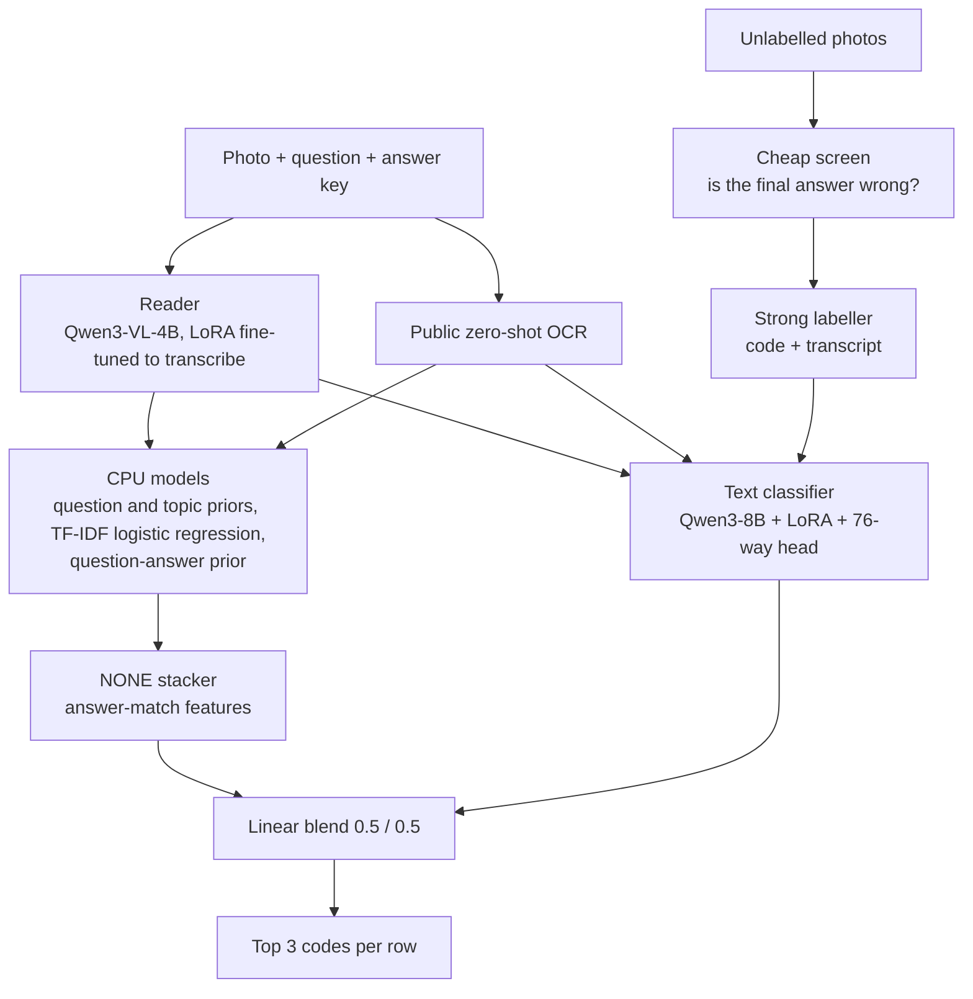

# K-12 Math Misconception Detection

[](https://github.com/r34l-rudr44/k12-misconception-detection/actions/workflows/ci.yml)
[](LICENSE)


Given a photo of a student's handwritten maths working, the question and the answer key, predict the **root
misconception** behind the mistakes: one of 75 taxonomy codes, or `NONE` when the working is essentially correct.

This is the code of my entry to the Kaggle competition
[Misconception Detection in K-12 Student Math Workings](https://www.kaggle.com/competitions/misconception-detection-in-k-12-student-math-workings)
(metric: MAP@3). It scored **0.6565 on the public leaderboard**, around the top third of about 400 teams when it was
submitted; the leading teams were near 0.85. It is not a winning solution. It is a complete pipeline in which every
step was measured, including the ones that did not help.

## The task

| | |
|---|---|
| Train | 1,500 photos with the root code, a human line-by-line transcription and annotated findings |
| Test | 3,498 photos with the question and the answer key only |
| Unlabelled | 50,000 photos of work on mostly the same questions |
| Labels | 75 misconception codes + `NONE`; a third of the rows are `NONE`; 25 codes have 5 examples or fewer |
| Language | Indonesian school maths, grades 4 to 12 |

Three facts about the data shape the whole design:

1. **`NONE` is almost the same as "the final answer is right".** In train, 487 of 506 `NONE` rows end with the correct
   answer and only 30 of 994 other rows do. A reliable check of the final answer against the key decides a third of
   the score.
2. **The question is a strong prior.** 96% of test questions also occur in train, and students tend to make the same
   mistake on the same question. The question prior alone scores about 0.47.
3. **Priors stop at about 0.65.** Even a perfect `NONE` detector on top of the question and topic priors reaches only
   0.65. Everything above that has to come from reading what the student actually wrote.

## Approach



**Reader.** Qwen3-VL-4B is fine-tuned with LoRA on the 1,500 human transcriptions and then transcribes every photo
into `L1 | ...` lines. Its text is closer to the human transcription than the zero-shot OCR that was publicly
available (similarity 0.63 to 0.66 against 0.57; the base model without fine-tuning: 0.48). All later models read
text, not pixels.

**CPU models** (`scripts/cpu_baseline.py`). A smoothed prior question → topic → global, a TF-IDF logistic regression
on question, key and transcription, and a prior on (question, student's final answer). They run on both OCR sources
and are blended with the public baseline's probabilities (`scripts/blend_cpu.py`).

**Answer matcher and `NONE` stacker** (`scripts/answer_match.py`, `scripts/none_stack.py`). The matcher decides
whether the last lines of a transcription contain the key. It handles `Rp30.000`, `3,625` against `3.625`, LaTeX
fractions, mixed numbers, units and rounding. A small logistic regression on these features re-estimates P(`NONE`).

**Text classifier** (`scripts/modal/text_cls.py`). Qwen3-8B with LoRA and a linear head over 76 classes, trained on
question + key + transcription. During training each row randomly shows the reader's text, the public OCR or the
human transcription, so the model learns from the noisy text it will see at test time.

**Pseudo-labels** (`scripts/modal/api_label.py`). The host allowed external APIs for labelling the unlabelled set (not
at inference). The unlabelled pool is about three quarters `NONE`, so it is screened first: a cheap model (Claude
Haiku) reads the final answer and compares it with the key, and only rows flagged as wrong go to a stronger model
(Claude Sonnet) for a code and a transcript. Rows are picked per question in proportion to how often the question
occurs in the test set. Before any unlabelled row was sent, the labeller was measured on held-out train rows: 0.77
MAP@3 on 300 rows, against 0.66 for the pipeline at that point. Test rows were never sent to an API.

## Results

| Step | Validation MAP@3 | Public LB |
|---|---|---|
| CPU models on public OCR | 0.554 (5-fold) | 0.562 |
| + public baseline probabilities, `NONE` scaled down | 0.575 (5-fold) | 0.589 |
| + per-class calibration | +0.003 (nested CV) | 0.593 |
| + direct diagnosis by the fine-tuned VLM | 0.600 (holdout) | 0.595 |
| CPU models on both OCR sources + `NONE` stacker | 0.597 (5-fold) | 0.608 |
| + Qwen3-8B text classifier | 0.659 (fold 0) | 0.627 |
| + 948 screened pseudo-labels, better answer matcher | 0.684 (fold 0) | **0.6565** |

What helped:

- **Screening before labelling.** Unscreened pseudo-labels (499 rows, 74% `NONE`) improved the 8B model alone but
  left the blend flat. Screened ones (26% of rows flagged; on a check of 40 train rows the flag was right for 39)
  lifted the 8B model from 0.593 to 0.661 and the blend from 0.659 to 0.684. The leaderboard moved by the same amount.
- **The answer matcher.** Recall on correct answers went from 0.72 to 0.83 after handling local number formats,
  worth +0.011 on the CPU blend.

What did not help:

- **Asking the VLM for the code directly.** The 4B model scored 0.49 to 0.53 alone and predicted `NONE` far too
  often. It is useful as a reader, not as a diagnoser.
- **A second, larger round of pseudo-labels** (1,814 rows in total). Fold 0 moved from 0.684 to 0.686, inside the
  noise of a 300-row validation fold (about ±0.02).
- **Pseudo-labels in the CPU models.** They gain alone (0.608 to 0.626) but the blend with the 8B model is flat.
- **Looking up (question, wrong final answer).** The same wrong answer to the same question has the same root code
  only about 62% of the time.

Where the remaining error is: the text classifier scores about 0.81 on misconception rows whose code it has seen on
the same question during training, and about 0.29 otherwise. The model recognises known mistakes on known questions
much better than it diagnoses new ones.

Two fixes in the text classifier were made on principle and not measured on their own: long inputs are truncated
from the left, so the student's final answer is never cut off, and annotator notes are stripped from the human
transcriptions (131 of them contain notes such as "student answered the question correctly", which give the label
away and never occur at test time). The model behind the best submission was trained before these two fixes; the
retrain that included them, together with the second round of pseudo-labels, scored the same within noise.

Limits of these numbers: only one fold of the 8B model was trained, so the blend weight rests on 300 validation rows;
and the reader saw 80% of the train photos during its own training, so train transcriptions are slightly cleaner
than test transcriptions.

## Repository layout

```
modal_app.py                Modal app: data download and all GPU jobs (reader, text classifier)
modal_api.py                Modal app: Claude labelling jobs with a metered spend cap
modal_cpu.py                Modal app: the CPU chain on a 16 GB container
scripts/
  eda.py                    first look at the tables
  cpu_baseline.py           priors + TF-IDF logistic regression on one OCR source
  answer_match.py           does the final answer equal the key?
  blend_cpu.py              blend of the CPU models and the public baseline
  none_stack.py             P(NONE) stacker
  prep_textdata.py          text bundle for the 8B classifier
  pick_for_screen.py        unlabelled rows for the cheap screen
  pick_for_labelling.py     screened rows for the strong labeller
  prep_pseudo.py            labeller output -> pseudo-labelled training set
  blend_final.py            8B classifier x CPU blend -> submission
  submit.py                 validate and submit a file
  modal_spawn.py            start a Modal job detached / poll it
  run_reader_chain.sh       fetch data -> fine-tune reader -> transcribe train and test
  modal/                    modules that run inside the Modal containers
    common.py               prompts and image loading for the VLM
    train_lora.py           VLM LoRA fine-tune (transcribe + diagnose)
    vllm_infer.py           vLLM inference: transcription and diagnosis
    infer_lora.py           transformers beam-search inference
    text_cls.py             Qwen3-8B classifier: train, checkpoint, predict
    api_label.py            Claude labelling: diagnose, transcribe, screen
    textdata/               generated inputs shipped to the containers (not in git)
  experiments/              earlier blending experiments, kept for reference
tests/                      unit tests for the answer matcher and the parsers
```

## Running it

The competition data is not part of this repository. You need to have joined the competition and accepted its rules.

### Setup

```bash
python -m venv .venv && source .venv/bin/activate    # Windows: .venv\Scripts\activate
pip install -r requirements.txt                      # CPU steps
pip install modal kaggle                             # cloud steps and submitting
pytest                                               # optional: unit tests
```

Local steps need only a CPU. `cpu_baseline.py` needs several GB of free memory; `modal_cpu.py` runs the same chain
in the cloud (4 cores, 16 GB) if your machine does not have it. GPU steps run on [Modal](https://modal.com) and need:

- `modal setup`, then a Modal secret `huggingface` holding `HF_TOKEN` (an account that accepted the terms of the
  dataset mirror `colearnlab/misconception-detection`);
- for pseudo-labelling only: a Modal secret `anthropic` holding `ANTHROPIC_API_KEY`.

Both are paid services. Every job has a hard timeout, and the labelling job refuses to start when its estimate would pass
the spend cap you give it.

### Data

```
data/
  train.csv  test.csv  unlabelled.csv  taxonomy_v1.csv  sample_submission.csv
  external/baseline_ocr/      outputs of the public baseline notebook (see Acknowledgements):
    ocr_{train,test}_qwen3.5-9b.csv
    probs_{oof,test}_baseline.npy  probs_meta_baseline.json
work/                         everything the scripts write
```

The CSV files come from the competition page. The images are only needed in the cloud; `fetch_data` downloads them
into a Modal volume.

### Pipeline

```bash
# 1. CPU models on the public OCR
python scripts/cpu_baseline.py

# 2. Reader: fine-tune Qwen3-VL-4B, transcribe train + test -> work/v1ocr/   (GPU, about 2 hours)
bash scripts/run_reader_chain.sh v1

# 3. CPU models on the reader's OCR, blend, NONE stacker
python scripts/cpu_baseline.py work/v1ocr v1
python scripts/blend_cpu.py
python scripts/none_stack.py work/cpu_blend_oof.npy work/cpu_blend_test.npy cpu_blend

# 4. Text classifier, fold 0                                                 (GPU, about 30 minutes)
python scripts/prep_textdata.py
modal deploy modal_app.py
python scripts/modal_spawn.py spawn train_text run=t1 fold=0
python scripts/modal_spawn.py poll <call id>
modal run modal_app.py::download --run t1

# 5. Blend and submit
python scripts/blend_final.py t1 fold0
python scripts/submit.py work/submission_t1_fold0_w0.5.csv "8B fold 0 x CPU blend"
```

Pseudo-labelling round (optional; the commands for the API jobs are in the docstring of `modal_api.py`):

```bash
python scripts/pick_for_screen.py 3000 unl_screen1                 # rows for the screen
#   -> api_label task=screen on unl_screen1, download the result to work/api/
python scripts/pick_for_labelling.py 600 unl_label1 work/api/api_claude-haiku-5-5_unl_screen1_screen_batch.csv
#   -> api_label transcribe=true on unl_label1, download the result to work/api/
#   -> vllm_run split= n_samples=0 transcribe=unlabelled ids=unl_label1   (the reader's text for the same photos)
python scripts/prep_pseudo.py work/api/api_claude-sonnet-5-5_unl_label1_tr_batch.csv \
    scripts/modal/textdata/unl_label1.csv pseudo1 work/v1/vllm_ocr_unlabelled_unl_label1.csv
modal deploy modal_app.py                                          # ships the new file
python scripts/modal_spawn.py spawn train_text run=p1 fold=0 extra=pseudo1
```

## Acknowledgements

- The competition and its data: CoLearn Lab, via Kaggle.
- The public notebook [K-12 baseline (LB 0.597)](https://www.kaggle.com/code/honghanhhh/k-12-baseline-lb-0-597) by
  honghanhhh: its zero-shot OCR files and its out-of-fold probabilities are inputs of the CPU blend.
- [Qwen3-VL](https://huggingface.co/Qwen) and Qwen3 models, [vLLM](https://github.com/vllm-project/vllm),
  [PEFT](https://github.com/huggingface/peft), [Modal](https://modal.com).

## License

The code is released under the [MIT License](LICENSE). The competition data and the public baseline's files are not
included and stay under their own terms.
